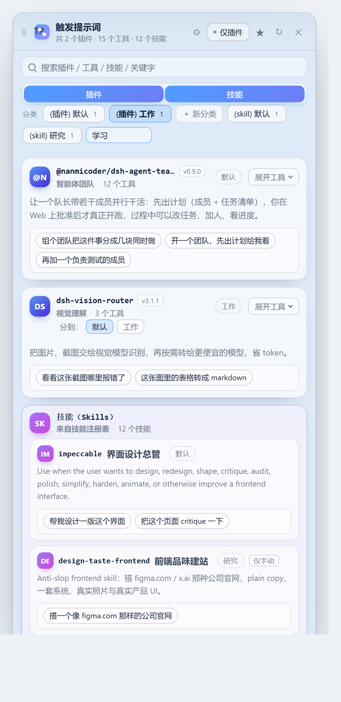

# dsh-trigger-prompts

给 [DeepSeek Harness](https://github.com/deepseek-ai) 装一个「触发词」按钮：**把每个插件注册给 Agent 的工具整理成中文清单——这插件是干嘛的、每个工具做什么、说什么话会触发它。**

入口就在聊天顶部的「对话 / 轨迹 / 画廊」右侧 —— 一个叫 **触发词** 的小按钮，点开是下拉面板。

> 为什么要它：插件是靠「工具名 + 工具描述」被模型自动识别的，而用户装完插件常常忘了自己授权了什么能力、该说什么话才会调用。这个插件把那层黑盒摊成一张中文说明书。
>
> 面板只展示中文说明，**不显示也不改变**模型真正看到的英文原文，更不影响工具是否被调用。



<sub>上图是静态渲染的设计预览（示例数据），实际面板会跟着 DSH 的主题色与你的插件走。</sub>

## 功能

| 功能 | 说明 |
| --- | --- |
| 按插件分组 | 每个已装 bundle 一张卡片（圆角 + 描边 + 浅底），卡片之间明显隔开 |
| 只列自装插件 | 默认只显示你自己装的插件，内置工具与 `mcp__*` 外部工具收进右上角「全部」 |
| 插件 3 行简介 | 卡片标题下一段简介：这插件能干什么（超出 3 行裁剪，悬停看全文） |
| 触发说法 | 简介下方用虚线框圈出一排「触发说法」胶囊，点一下即复制 |
| 工具默认收起 | 卡片只显示插件本身与触发说法；标题右侧「展开工具」按钮点开才列出这个插件的工具（再点变「收起工具」） |
| 工具一句话用途 | 展开后每条工具给一句中文说明，替代冗长的英文描述 |
| 插件 / 技能筛选 | 搜索框下两个按钮分别显隐「插件」与「技能」；至少保留一个，重新打开的那节排到下方（顺序记 localStorage） |
| 技能一节 | 面板里单列「技能（Skills）」：名字 + 完整 description + 触发说法 + 何时用 + 来源路径。skill 不是工具，走的是 `ctx.skills` 注册表 |
| 分类 | 筛选按钮下方一行「分类」：默认有一个「默认」格子，点「＋ 新分类」输入名字回车即建格子。点卡片右上角的分类芯片（虚线那个）选格子就能把它归进去；点格子只显示该分类的条目，再点一次取消。插件与技能的格子**各管各的**；两节同时亮着时格名前带 `(插件)` / `(skill)` 前缀避免混淆 |
| 外观设置 | 齿轮 ⚙ 里可调背景色（默认浅蓝 `#dce9f7`）与透明度（35%–100%），一键恢复默认 |
| MCP 单独一组 | 切到「全部」时，`mcp__*` 工具单独归入「MCP 外部工具」，不与内置混在一起 |
| 与页签对齐 | 运行时量一个原生页签（对话 / 轨迹 / 画廊），把按钮的高度、字号、字重、内边距、行内间距抄过来，换主题或缩放也不跑偏 |
| 按钮可移动 | 长按「触发词」约 0.26 秒拿起，只能在页签行（= 对话区之外）里挪动，拖不进对话区；右键单击回原位；位移记在 localStorage |
| 拖拽抓手 | 面板标题左侧 ⠿，长按约 0.25 秒后可拖动整个面板，双击复位；位置记在 localStorage |
| 搜索 | 顶部输入框按插件名 / 中文名 / 触发说法 / 工具名 / 中文说明 / 技能描述过滤 |
| 置顶 | 面板右上角 ★，置顶后与页面其它区域交互（点聊天、切视图、滚轮）都不会自动关闭；状态记在 localStorage |
| 刷新 | ↻ 重新拉取注册表（宿主侧有 8 秒缓存，归属扫描 60 秒缓存） |

关闭方式：再点一次按钮、点面板外空白处（未置顶时）、按 `Esc`、点面板右上角 ✕。

## 安装

```bash
# 本地目录安装（开发）
dsh plugin --profile desktop add "link:D:/dsh-plugins/dsh-trigger-prompts"

# 或从 npm 装（发布之后）
dsh plugin --profile desktop add dsh-trigger-prompts
```

装完 **退出并重新打开 DSH**。宿主侧插件要重启才挂载，客户端按钮随页面一起加载。

验证宿主侧是否生效：

```
GET http://127.0.0.1:19387/plugins/dsh-trigger-prompts/list
GET http://127.0.0.1:19387/plugins/dsh-trigger-prompts/zh-cn.json
```

返回形如：

```json
{
  "ok": true,
  "profile": "desktop",
  "tools": [
    { "name": "doubao_paint", "description": "把生图/P图任务交给本机的「豆包」…", "plugin": "dsh-doubao-painter" },
    { "name": "generate_image", "description": "Generate a new image…", "plugin": "dsh-image-gen" }
  ],
  "plugins": [{ "id": "dsh-image-gen", "version": "0.10.2", "count": 3 }],
  "skills": [
    {
      "name": "impeccable",
      "description": "前端界面设计 / 重构 / critique 的技能…",
      "whenToUse": "需要设计或改造界面时…",
      "source": "project",
      "path": "C:/ws/.dsh/skills/impeccable/SKILL.md",
      "cwd": "C:/ws"
    }
  ]
}
```

## 工作原理

**宿主侧**（`lib/index.js`）

1. `ctx.tools.schemas()` —— DSH 工具注册表对外的只读视图，返回每个工具 `name / description / parameters`。这就是模型每轮推理时看到的那份内容，未做任何加工。
2. 归属推测：读各 profile 的 `dsh.profile.bundles`，对每个 bundle 的 `lib/**.js` 做**字符串匹配**（找 `"工具名"`），命中即认为该插件注册了它。不执行插件代码、不调用工具；多个 profile 共用 pnpm store 时同一物理包只读一次。
3. 结果挂到两个只读接口：`/list`（工具清单，8 秒内存缓存）与 `/zh-cn.json`（中文注释表，读 `data/zh-cn.json`）。
4. `ctx.skills.snapshot({ cwd })` —— 技能注册表。skill **不是**工具：它不注册进工具表，而是由 `dsh-tool-skill` 把 `name + description` 渲染成上下文里的 `<available_skills>` 目录，正文加载走唯一的 `skill` 工具。项目级技能根（`<workspace>/.dsh/skills`）要按 `cwd` 才能被发现，所以按「`~/.dsh/storages/workspace.json` 记录的工作区 + 当前进程 cwd」逐个取快照后按名字合并（最多 6 个）。
5. **补扫兜底**：不带 `scope` 的快照只能看到全局根（bundled 等），项目级 `<cwd>/.dsh/skills` 与 `<cwd>/.agents/skills` 常常拿不到，所以再自己按这两个根读一遍（一层深、`<名字>/SKILL.md`，只取 frontmatter 里的 `name` / `description` / `whenToUse` / 两个 invocation 布尔键），与快照结果按名字合并、快照优先。这样「D 盘装的 skill」也能列进面板。

**客户端**（`client.js`）

1. 宿主没有给「页签行尾部」留插槽 —— `conversation.view` 注册的是真正的视图页签，点下去会切换主区域。所以这里用 DOM 观察找到 `[data-conversation-tabs]`，把按钮**追加为页签行的最后一个子元素**，位置正好在「画廊」右边。
2. `MutationObserver` + 2 秒兜底定时器保证 React 重渲染、切换会话后按钮仍在。
3. 面板挂到 `document.body`，用 `position: fixed` 跟随按钮定位；配色走 CSS 系统色（`Canvas` / `CanvasText`），深浅色主题都跟得上。
4. 不依赖 React、不需要构建：客户端入口就是一段可直接加载的 IIFE。

## 中文说明表

插件注册的工具描述大多是英文（那是给模型看的原文），而很多用户装完插件就忘了「该说什么话」才会触发它。所以面板完全用中文呈现：

- 数据在 `data/zh-cn.json`，结构：
  - `plugins[包名] = { name, intro, say }`：`name` 中文名，`intro` 一段简介（这插件干什么，面板 3 行裁剪），`say` 是触发说法数组（面板渲染成可点击复制的胶囊）；
  - `skills[技能名] = { name, say }`：`name` 中文短名，`say` 是这个技能的触发说法（与插件同款胶囊）；
  - `tools[工具名] = "一句话用途"`：逐条中文说明；没收录的工具只显示工具名，不会显示英文；
- 默认只列**你自己装的插件**；内置工具与 `mcp__*` 外部工具点右上角「全部」才显示（状态记 localStorage）；
- 插件卡片默认不展开工具清单，点标题右侧「展开工具」才看到；展开状态只记在内存里，刷新后回到收起；
- 面板的「插件 / 技能」两节可以用搜索框下的按钮分别显隐，至少保留一节；重新打开的那节会排到下方（顺序记 localStorage）；
- 只是展示层，**不改变**模型看到的描述，也不影响工具是否被调用；
- 想补条目：编辑 `data/zh-cn.json` 后重启 DSH 即可，不需要改代码；欢迎 PR。

附带修的一个坑：归属扫描会跳过 `data/`、`docs/`、`tests/` 目录，否则中文说明表里出现的工具名会让插件把这些工具误算成自己注册的。

## 拖拽

面板标题左侧有个 ⠿ 抓手：

- **长按约 0.25 秒**后抓起（鼠标会变成 grabbing），拖动即可把面板挪到任意位置；
- 长按过程中若明显移动（>8px）视为误触，不会进入拖拽；
- 双击抓手复位到「触发词」按钮下方；
- 位置记在 localStorage，重开 DSH 仍在原处；窗口变小时会自动夹回视口内。

## 外观设置

标题右侧的齿轮 ⚙（就在「仅插件」左边）展开设置区：

- **背景色**：默认浅蓝 `#dce9f7`，可用取色器任选，也有 5 个预设色点（浅蓝 / 浅绿 / 浅紫 / 浅黄 / 深灰）；
- **透明度**：35%–100%，数值实时显示；
- **恢复默认**：一键回到浅蓝 + 92%；
- 文字颜色按背景亮度自动切深/浅（亮底配 `#16233a`，暗底配 `#eef4ff`），所以选深灰色也不会变成看不清；
- 选择存在 localStorage（`dsh-trigger-prompts:theme`），重开 DSH 保持。

## 已知限制

- **归属是推测的**：靠源码里是否出现工具名字符串判断。工具名若出现在两个包里会归给先扫到的那个；压缩/拼接严重的包里可能漏判，此时该工具落到「内置 / 其它」。
- **中文说明是人工维护的**：只有 `data/zh-cn.json` 里收录的工具才有说明；没收录的工具只显示名字。新装插件建议补一条（欢迎 PR）。
- **按钮是 DOM 注入**而不是官方插槽：DSH 大版本改页签结构时可能需要跟着改选择器（当前按 `[data-conversation-tabs]` 定位）。按钮不在页签的 `role="tab"` 序列里，键盘 Tab 导航不包含它（鼠标/触控正常）。
- **按钮移动范围就是页签行的矩形**：拖不出这一行，也就进不了对话区。页签行如果被上游套了额外容器，需要同时改 `tabsContainer()` 的选择器，否则位移上限会退化成一个保守的小范围。
- **只读**：不修改任何工具描述，也不改变工具是否被调用；要看完整 JSON（含英文 description 与 parameters）请直接请求 `/list` 接口。
- 面板不渲染英文原文，也不渲染参数 schema。
- **技能依赖技能注册表 + 补扫**：`skills` 服务缺失时只剩补扫结果；由**别的插件**在运行时注册的技能（例如 `reverse-engineer-anything` 这类随插件分发的 skill）没有 `scope` 就拿不到，可能不在面板里。技能按「`~/.dsh/storages/workspace.json` 记录的工作区 + 当前进程 cwd」发现，工作区既不在该文件里、也不是当前 cwd 时可能列不全。
- **分类只能建、不能改名或删除**：格子存在 localStorage（`dsh-trigger-prompts:cats`），只能建新格子和把条目挪进去；删格子要手动清那条 localStorage，代价是那一类的条目会退回「默认」。
- **宿主侧改动要重启 DSH**：`lib/index.js` 的改动不会热更新；`data/zh-cn.json`、`client.js` 改完刷新页面即可。

## 开发

```bash
node tests/smoke.mjs       # 假 ctx 跑通：注册路由 → 归属 → HTTP 响应
node tests/render-sim.mjs  # 最小 DOM 桩跑客户端：默认收起工具 / 展开 / 插件·技能筛选顺序 / 分类新建与归档 / 技能触发说法 / 页签对齐 / 长按拖动与右键复位
```

无第三方依赖，`node >= 20`。

## License

MIT © stook-404
